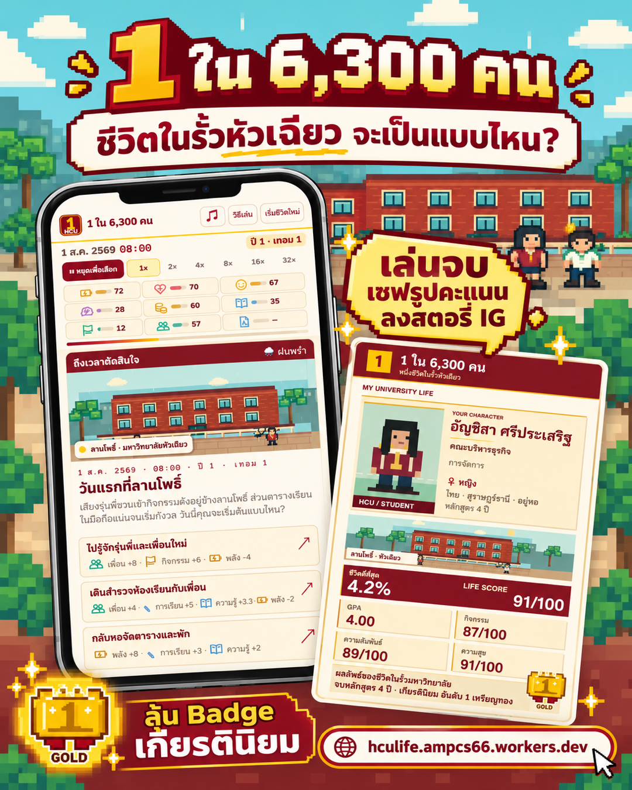
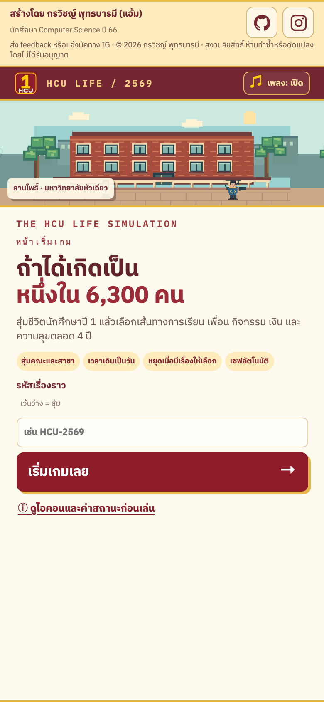
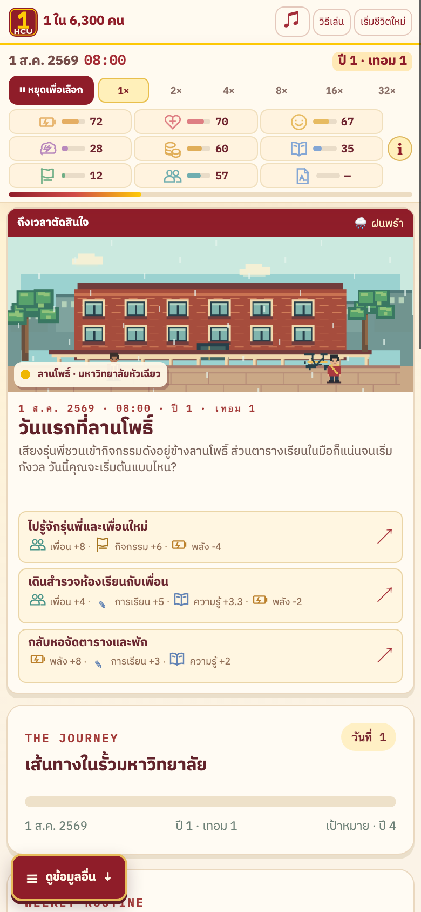
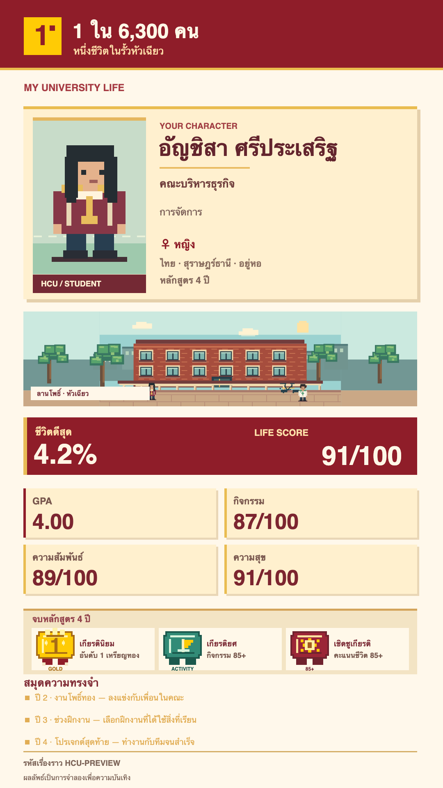

<p align="center">
  
</p>

<h1 align="center">1 ใน 6,300 คน</h1>

<p align="center"><code>HCU LIFE / 2569</code> · เกมจำลองชีวิตนักศึกษา 4 ปี · หนึ่งชีวิต หนึ่งเส้นทาง</p>

<p align="center">
  <a href="https://hculife.ampcs66.workers.dev/"><strong>▶ PRESS START — เล่นเกมบน Cloudflare</strong></a>
  &nbsp;·&nbsp;
  <a href="#local-play">เปิดในเครื่อง</a>
  &nbsp;·&nbsp;
  <a href="#github-upload">นำขึ้น GitHub</a>
</p>

<p align="center">
  <a href="https://hculife.ampcs66.workers.dev/">
    
  </a>
</p>

> **INSERT COIN · เริ่มชีวิตใหม่**
>
> สุ่มเป็นนักศึกษาหัวเฉียว เลือกเส้นทางการเรียน เพื่อน กิจกรรม เงิน และความสุข ตั้งแต่ปี 1 จนถึงวันจบการศึกษา แล้วดูว่าชีวิตนี้จะเป็น **1 ใน 6,300 คน** แบบไหน

## 🕹️ GAME MENU

| ด่าน | สิ่งที่เจอ |
| :-- | :-- |
| `01 / NEW GAME` | สุ่มตัวละคร คณะ สาขา และรหัสเรื่องราวเพื่อเริ่มเส้นทางใหม่ |
| `02 / CHOOSE` | ตัดสินใจในเหตุการณ์ประจำวัน บางตัวเลือกส่งผลต่อเนื่องในวันถัดไป |
| `03 / LEVEL UP` | ดูแลพลัง สุขภาพ ความสุข ความเครียด เงิน ความรู้ กิจกรรม และความสัมพันธ์ |
| `04 / SAVE` | บันทึกความคืบหน้าอัตโนมัติในเบราว์เซอร์ด้วย `localStorage` |
| `05 / ENDING` | ดูผลชีวิตเทียบกับการจำลอง 6,300 รอบ รับ Badge และดาวน์โหลดภาพสรุปลงสตอรี |

ฉากพิกเซลอาร์ตในเกมวาดด้วย SVG และเพลงประกอบสร้างด้วย Web Audio API ไม่ต้องโหลดไฟล์ภาพฉากหรือเสียงจากบริการภายนอก เกมเล่นได้ทั้งมือถือและคอมพิวเตอร์โดยไม่ต้องสมัครบัญชี

## 📺 ตัวอย่างหน้าจอ

<p align="center">
  
  
</p>

<details>
<summary>ดูตัวอย่างภาพสรุปเมื่อจบเกม</summary>

<p align="center"></p>

</details>

<a id="local-play"></a>

## 💾 เปิดเกมในเครื่อง

โปรเจกต์นี้เป็นเว็บ static ไม่ต้องติดตั้งแพ็กเกจหรือ build ก่อนเล่น:

```sh
python3 -m http.server 4173 --directory dist
```

เปิด <http://localhost:4173> ในเบราว์เซอร์ เซฟเกมจะอยู่ใน `localStorage` ของเบราว์เซอร์และโดเมนนั้น

## ☁️ โฮสต์เกมบน Cloudflare

ลิงก์ที่ใช้เล่นเกมคือ **[hculife.ampcs66.workers.dev](https://hculife.ampcs66.workers.dev/)** ซึ่งโฮสต์ด้วย Cloudflare Workers และใช้ไฟล์ใน `dist/` ตาม `wrangler.jsonc`

เมื่อต้องการอัปเดตเว็บที่โฮสต์อยู่:

```sh
npx wrangler login   # ใช้ครั้งแรกเพื่อเชื่อมบัญชี Cloudflare
npx wrangler deploy
```

ถ้าใช้ Cloudflare Pages ให้ตั้ง build command ว่าง และ output directory เป็น `dist` การอัปโหลดซอร์สขึ้น GitHub อย่างเดียวจะยังไม่อัปเดตเว็บบน Cloudflare จนกว่าจะเชื่อมการ deploy หรือรันคำสั่ง deploy เอง

<a id="github-upload"></a>

## 🗃️ วิธีนำโปรเจกต์ขึ้น GitHub

โฟลเดอร์นี้เตรียม Git repository สาขา `main` ไว้แล้ว ให้สร้าง **repository ว่าง** บน GitHub แล้วเพิ่ม remote และ push (เปลี่ยน URL ตามชื่อ repository ที่สร้าง):

```sh
git remote add origin https://github.com/Ampsoria/Amp_1in5000HCU.git
git push -u origin main
```

ไฟล์ `dist/` เป็นตัวเกมจริงและอยู่ใน Git ส่วนแคช `.wrangler/`, ไฟล์ `.env`, ไฟล์ระบบ และ ZIP สำหรับอัปโหลดตรงถูกกันไว้ใน `.gitignore` ปุ่มเล่นเกมใน README ชี้ไปยังเว็บที่โฮสต์บน **Cloudflare**

## 🧪 ตรวจการทำงาน

```sh
node --check dist/app.js
node --check dist/music.js
node tests/music.mjs
node tests/simulate.mjs
```

<details>
<summary>ข้อมูลในเกมและข้อควรรู้</summary>

- `dist/courses.json` คัดลอกจาก `Amp_HcuNoteShare/src/data/courses.json` เพื่อสร้างเรื่องราวในเกม ไม่ใช่แผนการเรียนหรือใบเกรดทางการ หน่วยกิต น้ำหนักคะแนน และการจัดวิชาแต่ละเทอมเป็นกติกาเกม
- เกมเลือกวิชาที่ตรงสาขาและชั้นปีก่อน แล้วผสมวิชา GE หากข้อมูลสาขามีน้อยจะใช้วิชาเลือกจากคณะเดียวกัน วันที่กิจกรรมเป็นส่วนหนึ่งของเรื่องราวจำลอง
- โอกาสสุ่มคณะอิงจำนวนผู้เข้าศึกษาใหม่ระดับปริญญาตรีของหัวเฉียวปีการศึกษา 2567 โดยประมาณ เปอร์เซ็นต์ผลลัพธ์เปรียบเทียบกับคะแนนชีวิตจำลอง 6,300 รอบ ไม่ใช่ผลจริงของนักศึกษา
- นาฬิกาเกมเดินตั้งแต่ 00:00–23:59 บันทึกเรื่องราวแสดงเหตุการณ์สำคัญ และตัวเลือกที่มีความเสี่ยงจะแสดงโอกาสก่อนกด
- ตัวละครไทยสุ่มชื่อจริง 118 ชื่อกับนามสกุล 60 ชื่อ ตัวละครจีนและฟิลิปปินส์มีชุดชื่อแยกต่างหาก ตัวละครผู้เล่นสุ่มเพศและชุดตามคณะ
- ภาพสรุปขนาด 1080 × 1920 พิกเซลมี Badge เกียรตินิยมตาม GPA และ Badge กิจกรรมหรือคะแนนชีวิตตามผลที่เล่น

</details>

---

<p align="center">
  <code>© 2026 กรวิชญ์ พุทธบารมี (แอ้ม) · ALL RIGHTS RESERVED</code><br>
  อ่านเงื่อนไขใน <a href="COPYRIGHT.md">COPYRIGHT.md</a> · ส่งข้อเสนอแนะหรือแจ้งบัคทาง <a href="https://www.instagram.com/ampokayampfinegwenchana/">Instagram</a>
</p>
